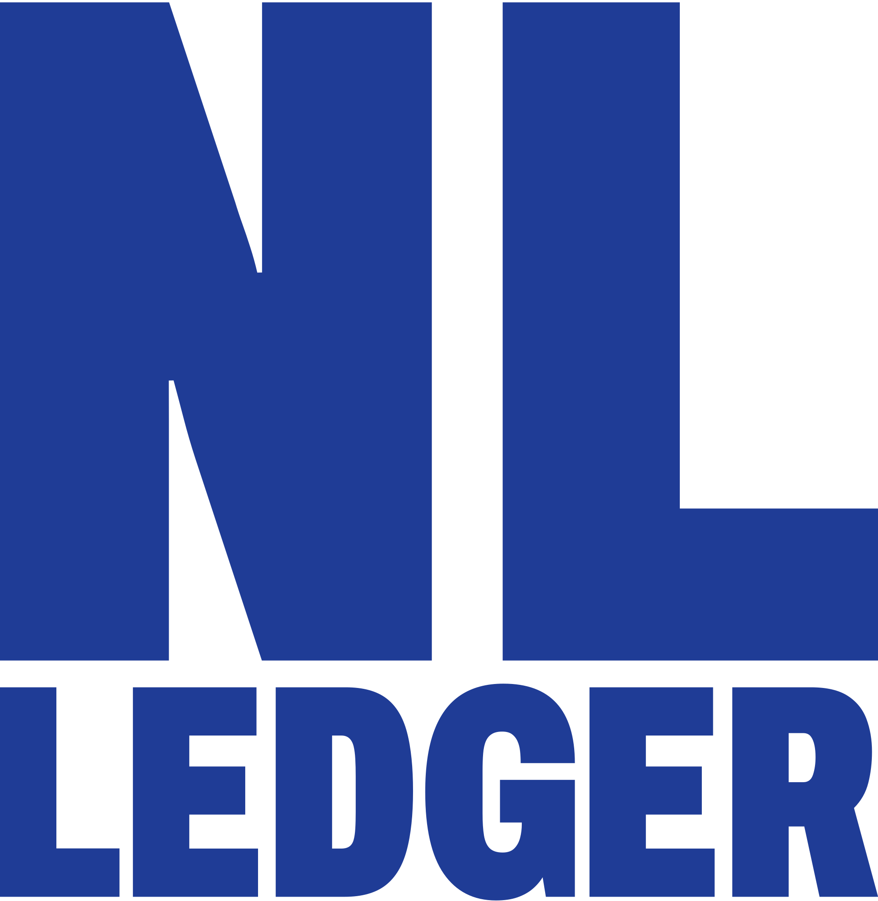

<p align="center">
  <a href="https://nlledger.ca">
    <picture>
      <source media="(prefers-color-scheme: dark)" srcset="brand/svg/wordmark-stacked-white.svg">
      
    </picture>
  </a>
</p>

<p align="center">
  <a href="https://nlledger.ca"><strong>nlledger.ca</strong></a> ·
  <a href="https://nlledger.ca/data/">Ask your AI</a> ·
  <a href="CONTRIBUTING.md">Contribute</a> ·
  <a href="https://github.com/steveclarke/nl-ledger/issues/new/choose">Report a figure or add a source</a>
</p>

# NL Ledger

NL Ledger gathers the spending records that Newfoundland and Labrador governments already publish and puts them in one searchable place: contract awards, minister and MHA expenses, public sector pay over $100,000, department budgets, federal contracts and grants in the province, and two municipal payment registers. Every figure links back to the document it came from. Live site: <https://nlledger.ca>.

It is a thought experiment in what public records can show an ordinary citizen. Three things to know before relying on it:

- **The figures are not independently vetted.** Records are read from PDFs, spreadsheets and scanned images by scripts. Totals are checked against the totals the sources print, and a sample of records was traced back by hand, but that is not an audit. Every record links to its source; open the source before relying on a figure.
- **Flags are questions, not findings.** The patterns the site counts (sole-source awards, contracts just under a limit, late publication and others) are things people ask about public spending. None is evidence that anything wrong happened.
- **There is no affiliation.** NL Ledger is not connected to any government, party or campaign.

**Help build it.** No programming is needed for most of what helps: a link to a source that is missing, a figure that does not match its document, or a better way to count something. Open one of the [issue forms](https://github.com/steveclarke/nl-ledger/issues/new/choose), pick up a source from the [wishlist](https://github.com/steveclarke/nl-ledger/labels/wishlist), or read [CONTRIBUTING.md](CONTRIBUTING.md).

## Who it is for

| If you are | Start here |
|---|---|
| A citizen | <https://nlledger.ca>: search any payment, see a department's spending, try the personal receipt |
| A journalist | The [sources](#sources) table, `docs/reconciliation.md` (what was checked against what) and the flag method pages on the site |
| A developer | [How it works](#how-it-works) and [Run it locally](#run-it-locally) below |
| Someone with an AI assistant | Connect it to the MCP server at <https://nlledger.ca/mcp>; the site's Ask your AI page has steps per client |

## Sources

Every line item comes from one of these. Coverage is what is loaded today.

| Source | Publisher | Coverage | Format |
|---|---|---|---|
| [Contract awards](https://www.gov.nl.ca/ppa/tenders/awarded/) | Public Procurement Agency, Government of Newfoundland and Labrador | Fortnightly reports of limited calls, exceptions to open calls and some open calls, 2020 to 2026 | PDF tables |
| [Ministers' expense claims](https://www.gov.nl.ca/exec/cabinet/expenseclaims/) | Executive Council, Government of Newfoundland and Labrador | Six-month periods, December 2020 to May 2026 | PDF text |
| [MHA expense reports](https://www.assembly.nl.ca/Members/Expenses/) | House of Assembly | Every line charged to each member's allowances, annual reports from 2020-21 | PDF text |
| [Compensation disclosure](https://www.gov.nl.ca/exec/tbs/home/publications/compensation-disclosure/) | Treasury Board Secretariat, Government of Newfoundland and Labrador | Everyone paid over $100,000, by employer, 2022 to 2025 | Excel workbooks |
| [Program expenditures and revenues](https://www.gov.nl.ca/exec/tbs/public-accounts/) | Treasury Board Secretariat, Government of Newfoundland and Labrador | Department and program spending, 2019-20 to 2024-25 | PDF text |
| [Budget estimates](https://www.gov.nl.ca/budget/2026/) | Government of Newfoundland and Labrador | 2026-27 budget by program | PDF text |
| [Contracts over $10,000](https://open.canada.ca/data/en/dataset/d8f85d91-7dec-4fd1-8055-483b77225d8b) | Government of Canada, Treasury Board Secretariat | Federal contracts with vendors in Newfoundland and Labrador | Bulk CSV |
| [Grants and contributions](https://open.canada.ca/data/en/dataset/432527ab-7aac-45b5-81d6-7597107a7013) | Government of Canada | Federal grants to recipients in Newfoundland and Labrador | Open data API |
| [Award notices](https://canadabuys.canada.ca/en/tender-opportunities/award-notices) | Public Services and Procurement Canada (CanadaBuys) | Federal awards to suppliers in the province, August 2022 on; shown, never added into totals | Bulk CSV |
| [Public Accounts, Volume III: professional and special services](https://www.tpsgc-pwgsc.gc.ca/recgen/cpc-pac/index-eng.html) | Receiver General for Canada | Payments over $100,000 to payees in the province, 2021-22 to 2024-25 | Bulk CSV |
| [Public Accounts, Volume III: transfer payments](https://www.tpsgc-pwgsc.gc.ca/recgen/cpc-pac/index-eng.html) | Receiver General for Canada | Transfers over $100,000 to recipients in the province, 2021-22 to 2024-25 | Bulk CSV |
| [Cheque register](https://www.paradise.ca/government-engage/cheque-register/) | Town of Paradise | Every payment, monthly, from mid-2020 | PDF text |
| [Payment vouchers](https://www.stjohns.ca/your-government/access-to-information-and-protection-of-privacy/proactive-disclosures/) | City of St. John's | A sample: the first pages of the 2026 weekly file | Scanned images, read by OCR |
| [Statistics Canada tables](https://www150.statcan.gc.ca/) 14-10-0064, 17-10-0009, 98-10-0002, 36-10-0450 | Statistics Canada | Median wage, population, households, provincial revenue: the denominators for per-person figures | Data tables |
| [Form NL428](https://www.canada.ca/en/revenue-agency.html) | Canada Revenue Agency | Provincial income tax brackets for the personal receipt | Web page |

Sources not yet included are listed in [`docs/wishlist.md`](docs/wishlist.md). Longer notes on each source, including access quirks, are in [`docs/sources.md`](docs/sources.md).

## How it works

1. **Fetch.** Scripts download each source and keep the original file with its address, a checksum and the time it was fetched.
2. **Parse.** Each source has its own reader for PDF tables, PDF text, Excel cells, CSV or OCR. Every record keeps a pointer to the file and page or row it came from.
3. **Check against printed totals.** Where a source prints its own totals, the parsed lines are added up and compared: every minister report, every MHA category and 173 of 175 department totals match. Sources that print no totals are checked by row counts and by a random sample traced by hand. Results are in [`docs/reconciliation.md`](docs/reconciliation.md) and [`docs/review-notes.md`](docs/review-notes.md).
4. **Count each amount once.** Federal files repeat a contract on every amendment. The build keeps the latest row per contract or agreement. The rules are on the site's Methods page.
5. **Flag patterns.** A set of documented patterns marks records that raise questions, such as repeat sole-source awards or amounts just under a procurement limit. Each pattern has a method page.
6. **Build.** The results go into a local SQLite database, then into a static site plus a small search index.
7. **Search index.** Line items are packed into search documents in a Cloudflare D1 database (`pipeline/d1_sync.py` sends only what changed), so search, supplier and record pages load quickly.
8. **MCP server.** The same data is available to AI assistants through a [Model Context Protocol](https://modelcontextprotocol.io) server at <https://nlledger.ca/mcp>, with tools to search records and look up members.

## Run it locally

You need [uv](https://docs.astral.sh/uv/) with Python 3.12 or newer, Node 22.13 or newer, and, for the St. John's scans, `pdftoppm` (poppler) and `tesseract`. No accounts or keys are needed.

```sh
# 1. Fetch the sources, parse them, check totals, write data/build/ledger.db
cd pipeline
./run.sh

# 2. Build the site and run the guardrail checks
cd ../site
npm install
node build.mjs
./check.sh
```

The pipeline takes about six minutes on a laptop. Downloads are cached in `data/cache/`; delete a file there to fetch it again. The federal contracts file is several hundred megabytes.

The build writes static pages to `site/dist/`; open them with any static file server (for example `npx serve site/dist`). Search, supplier, record and receipt pages run as Worker code against the D1 search index, so they need a Cloudflare setup; the rest of the site works without one. Deploying and syncing the index are maintainer steps, described in [`NOTES.md`](NOTES.md).

## Project layout

| Path | What |
|---|---|
| `pipeline/` | Python. Fetch, parse, build, flags, reconcile, export |
| `pipeline/d1_sync.py` | Pushes changed search documents to the D1 index (maintainers only) |
| `site/` | Static build (`build.mjs`, `src/pages/`), shared code (`lib/`), the Worker (`worker.mjs`) and its request-time routes (`routes/`), including the MCP server (`lib/mcp.mjs`) |
| `docs/` | Sources, reconciliation, trace sample, review notes, wishlist |
| `brand/` | Logo, icons, social images and the brand guide (`brand/index.html`) |
| `DESIGN.md` | The site's design system: colours, type, components |
| `NOTES.md` | Hosting, deploys and what is and is not verified |
| `data/` | Created by the pipeline; not in git |

## Contributing

Corrections, new sources and challenges to a method are welcome, from programmers and non-programmers alike. See [CONTRIBUTING.md](CONTRIBUTING.md).

## Licence

The code is released under the [MIT licence](LICENSE).

The data is not covered by that licence. Each record stays under the licence of the body that published it:

- Federal records: [Open Government Licence – Canada](https://open.canada.ca/en/open-government-licence-canada).
- Newfoundland and Labrador records: the province's open government licence, published with the [provincial open data portal](https://opendata.gov.nl.ca/). Where a page carries its own terms, those apply.
- Municipal records (Paradise, St. John's) and Statistics Canada tables: the terms on each publisher's own site.

Reuse of any figure follows the licence of the source it links to.
